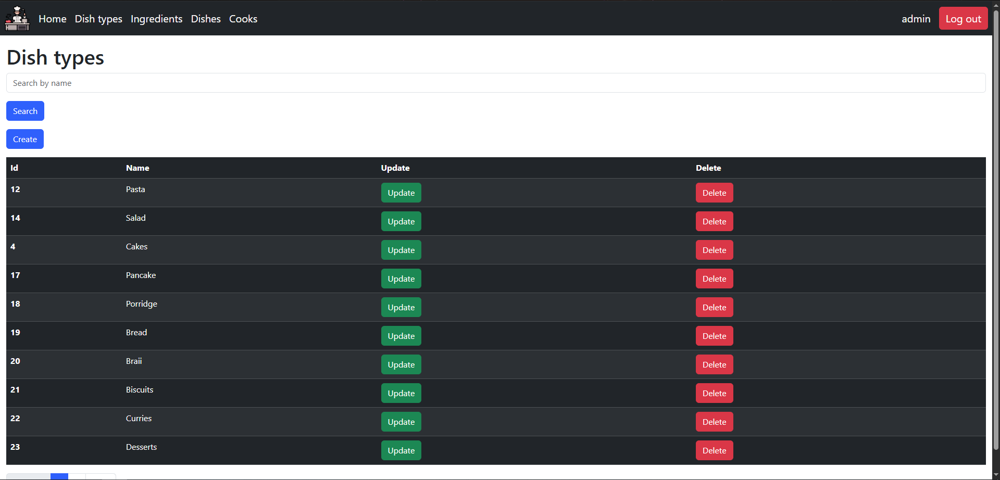
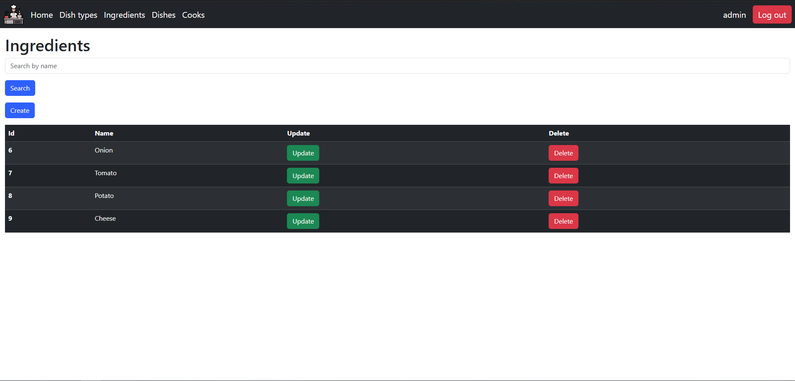

# Restaurant Kitchen Service

## Description
This project is designed using Flask and its extensions to manage all information related to dishes.
### Features:
- Create and update dish types, ingredients, dishes and cooks (as moderator/admin);
- Delete dish types, ingredients, dishes and cooks (as admin);
- Listing dish types, ingredients, dishes and cooks (as user/moderator/admin);
- Custom admin panel - via `/admin/` (as admin);
- User registration and log in simultaneously;
- Log in and log out;
- Change current user password;

Database structure:

Login page:

Signup page:

Home page:

Dish types page:

Create dish type page:

Update dish type page:

Delete dish type page:

Ingredients page:

Create ingredient page:

Update ingredient page:

Delete ingredient page:

